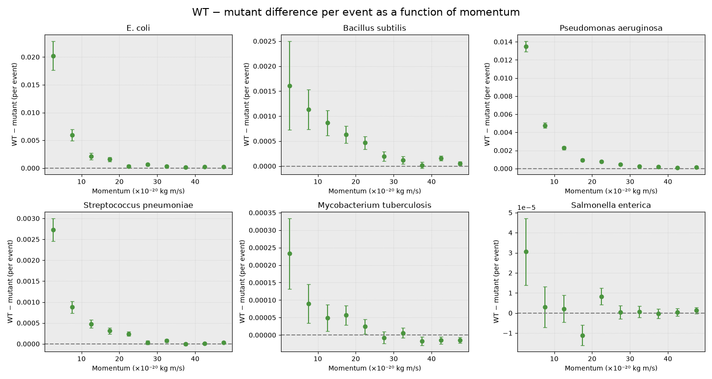

# **Monitoring Bacterial Movement and Populations**
## _Description_
This project aims to compare the bacterial movement and population growth under specific nutrient or stress conditions. 

The data were obtained from a simulation of bacterial tracking experiment. Each input contains the ID of experiment run, number of bacteria tracked, their 3D momentum components (px, py, pz) in 10⁻²⁰ kg m/s and ID of bacterial strain or genetic variant.

The data set contains following bacterial strains:

* _E. coli WT_ (wild type)
* _E. coli mutant_
* _Bacillus subtilis WT_ (wild type)
* _Bacillus subtilis mutant_
* _Pseudomonas aeruginosa WT_ (wild type)
* _Pseudomonas aeruginosa antibiotic-resistant_
* _Streptococcus pneumoniae_
* _Capsule-deficient streptococcus pneumoniae_
* _Mycobacterium tuberculosis_
* _Drug-resistant mycobacterium tuberculosis_
* _Salmonella enterica_
* _Salmonella mutant_

## _Research Questions_
The project focuses on answering the following research questions:

1. What are the average counts and statistical uncertainties of each bacterial strain?
2. Is there any asymmetry between the normal and the mutant strain, if so - how large is it?
3. Is there any asymmetry between the normal and the mutant strain as a function of their momentum?

## _Results_

10 files were analysed. Empty events were removed from further analyses and therefore 4614632 events were analysed in this experiment. 

To calculate average bacterial count the subsampling method was applied. Each file was treated as one subsample. For each subsample the count per event of each strain was calculated, and the final value is the weighted-mean per event over all 10 subsamples. Uncertainty is standard deviation of subsample averages.

__1. The project indicates the following average counts and statistical uncertainties for each bacterial strain:__

* E. coli WT: 19.96404 ± 0.03277

* E. coli mutant: 19.93172 ± 0.03186

* Bacillus subtilis WT: 2.51098 ± 0.00476

* Bacillus subtilis mutant: 2.50528 ± 0.00551

* Pseudomonas aeruginosa WT: 1.20891 ± 0.00192

* Pseudomonas aeruginosa antibiotic-resistant: 1.18502 ± 0.00242

* Streptococcus pneumoniae:  0.2768 ± 0.00108

* Capsule-deficient streptococcus pneumoniae: 0.27189 ± 0.00099

* Mycobacterium tuberculosis: 0.03947 ± 0.00028

* Drug-resistant mycobacterium tuberculosis: 0.03903 ± 0.0004

* Salmonella enterica: 0.00119 ± 4e-05

* Salmonella mutant: 0.00115 ± 5e-05

__2. The table below illustrates the differences between the normal and the mutant strain:__


| Bacterial strains | Reported difference | Significant (>3std) |
|:---:|:---:| :--:|
| E. coli WT VS E. coli mutant | 0.03232 ± 0.00452| Yes |
|Bacillus subtilis WT VS Bacillus subtilis mutant | 0.0057 ± 0.0033| No |
|Pseudomonas aeruginosa WT VS Pseudomonas aeruginosa antibiotic-resistant | 0.02389 ± 0.00237| Yes |
|Streptococcus pneumoniae VS Capsule-deficient streptococcus pneumoniae | 0.00491 ± 0.00058| Yes |
|Mycobacterium tuberculosis VS Drug-resistant mycobacterium tuberculosis | 0.00044 ± 0.00049|  No |
|Salmonella enterica VS Salmonella mutant| 4e-05 ± 7e-05| No |

<br>
<br>
Uncertainties are the standard deviation of single subsamples, a conservative estimate.<br>
The difference was considered significant if it exceeded 3 standard deviations. 

__3. Bacterial asymmetry as a function of momentum__


Momentum quantifies the motion of an object, it is calculated by multiplying mass and velocity. In this experiment the following formula was applied $p = \sqrt{p_x^2 + p_y^2 + p_z^2}$, where p<sub>x</sub>, p<sub>y</sub>, p<sub>z</sub> are momentum's components in different dimensions. 
At first in each subsample bacteria were separated in 10 bins of equal width (5 ×10⁻²⁰ kg m/s) from 0 to 50 per strain. For each bin, wild-type and mutant
counts were summed over all 10 subsamples and their difference was divided by the total number of events. Per-bin uncertainties follow the Poisson distribution: $$\sigma = \frac{\sqrt{N_{WT} + N_{mutant}}}{N_{events}}$$



The plot indicates the assymmetry between bacterium wild type and mutant for 6 bacterium species. The error bars signify one standard deviation.

## Conclusion
A significant asymmetry (exceeding 3 standard deviations) was discovered for E. coli (WT,mutant), Pseudomonas aeruginosa (WT, antibiotic-resistant), Streptococcus pneumoniae (normal, capsule-deficient) with the wild type more abundant in all three. For the rest of species - Bacillus subtilis, Mycobacterium tuberculosis and Salmonella enterica - no significant difference was found. <br>
As a function of momentum the asymmetry decreases with momentum: it is larger for low momentum with high bacterial counts and lower for large momentum with low bacterial counts. Absolute errorbars decrease with increase of momentum, but increase relative to the difference. 


## _Installation_
1. Make sure you have Python 3 installed. 
2. Additionally NumPy and Matplotlib packages are required:
```bash
pip install numpy
pip install matplotlib
```

3. Clone the repository
```bash
git clone https://github.com/sofijaponomarjova/Monitoring-Bacterial-Movement-and-Population.git
cd Monitoring-Bacterial-Movement-and-Population
```
**Alternatively, download the repository as a ZIP file:**
* Press green button "<> Code"
* Click "Download ZIP"

**Dataset**

You can download the dataset files here: https://surfdrive.surf.nl/index.php/s/7udCnWTk4yMUASD 

Please store all the files in one folder as program asks for folder's pathway!!<br>
output-Set0.txt (a single test event) is excluded automatically.


## _Usage_
1. Open the repository in your VSC
2. Run in Terminal file of your choice:

```python3 *file of your choice*```

* task2.py - cleans the data and then calculates the momentum for each bacteria
* week3.py - calculates the average amount of a bacterial strain per event/experiment in 1 sample
* week4.py - calculates the average amount of a bacterial strain per event/experiment in all 10 samples (main results)
* week5.py - plots the assymmetry between WT and mutants as a function of momentum
